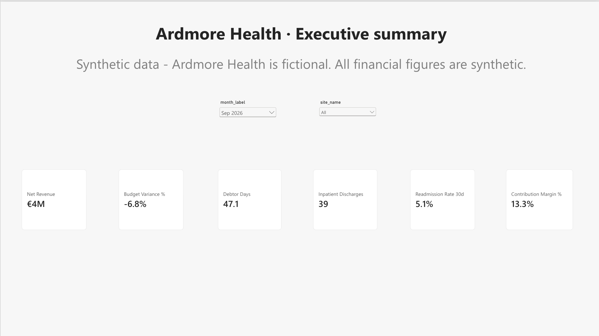
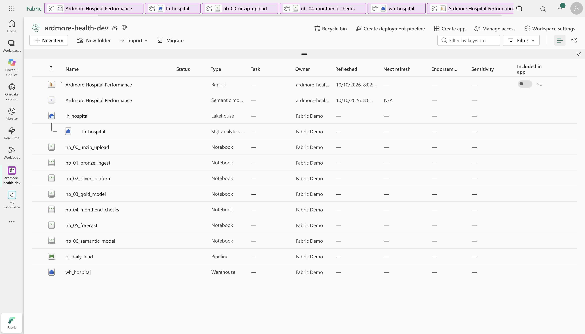
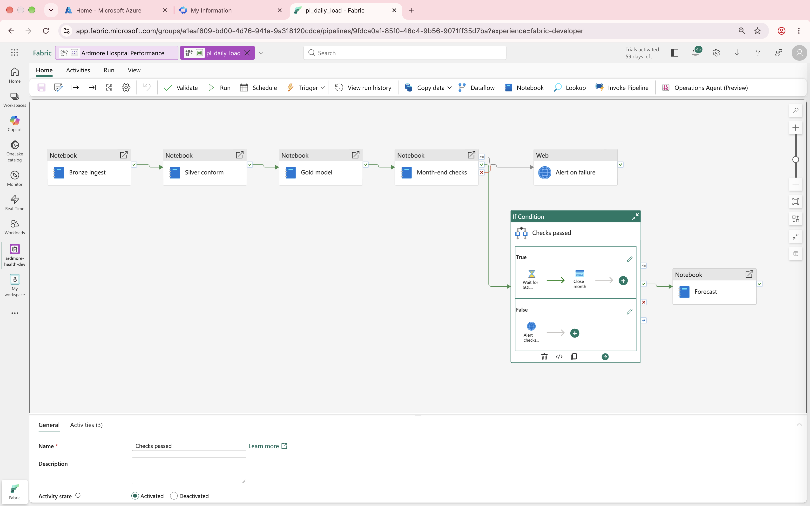
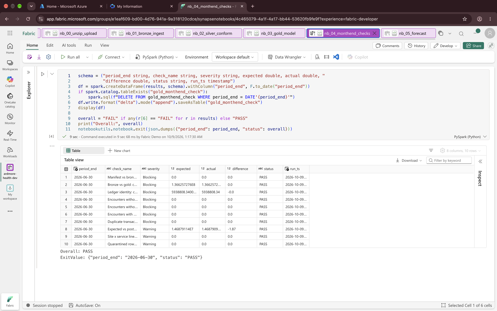
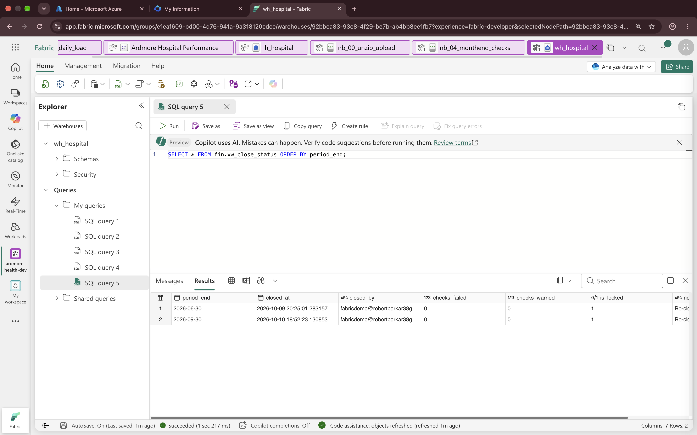
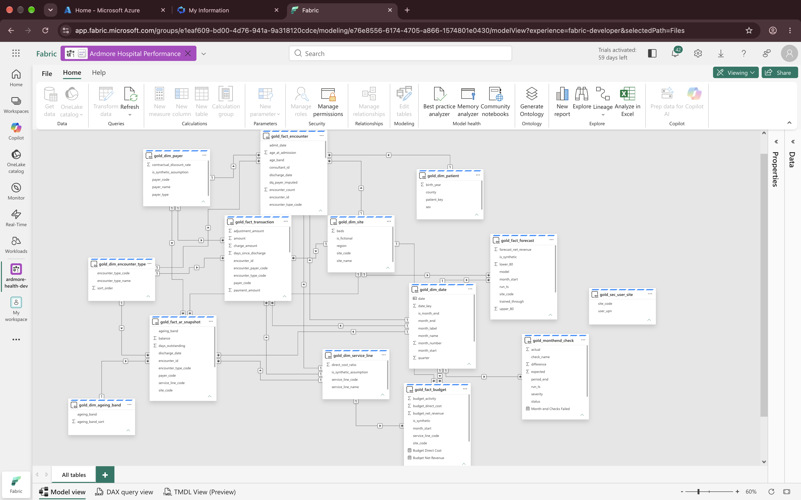
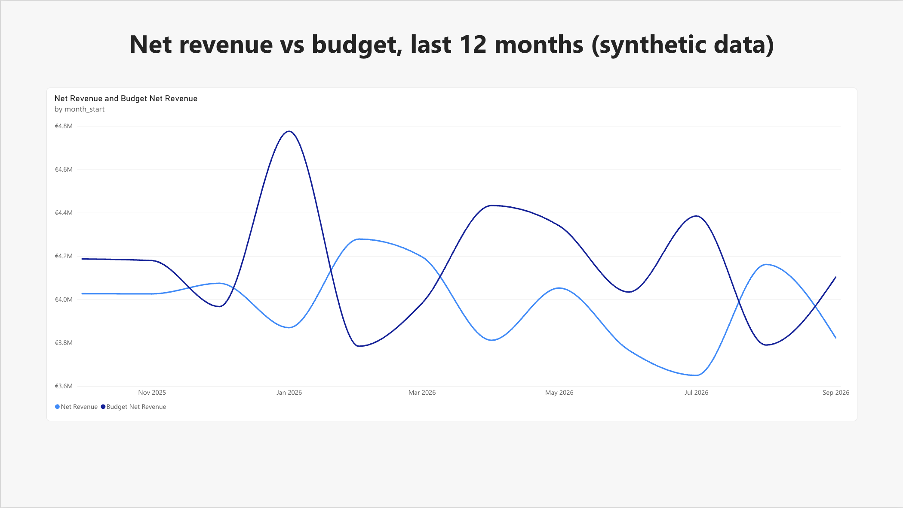
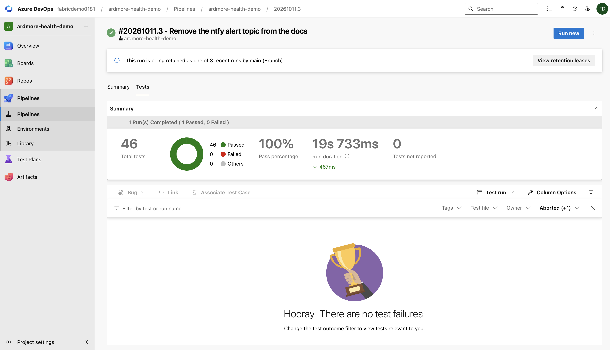
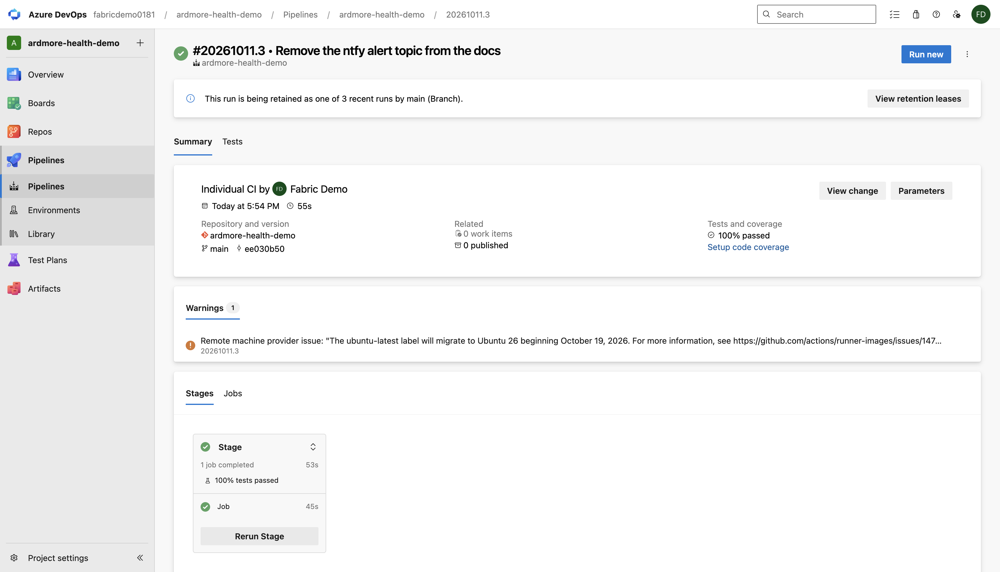
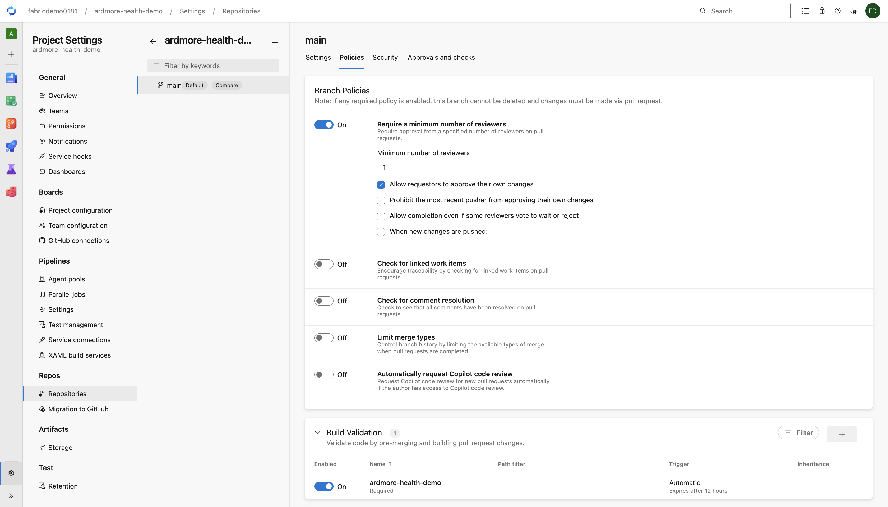

# Hospital Revenue and Performance Platform (Microsoft Fabric)

I built this to learn and show the work a hospital BI developer does every month: load data from the hospital
system, check it, close the month for finance, and report on it in Power BI.

Everything runs in Microsoft Fabric. A pipeline loads monthly export files into a lakehouse, cleans them, builds
a star schema, runs 10 reconciliation checks, and closes the month in a warehouse. A Direct Lake semantic model
and a Power BI report sit on top.

> **All data is synthetic.** "Ardmore Health" and its three sites (Dublin South, Dublin West, Galway) are made up.
> Patients come from Synthea and every money figure is invented. The export files only copy the shape of a
> hospital system extract. **This is not MEDITECH** and no real patient or hospital data is used.



## The problem

At month end, finance numbers and activity numbers in a hospital often come from different extracts. Someone
joins them in Excel and they rarely match. Here both come from one pipeline, and the month is only closed after
10 checks prove the numbers agree.

## What I built

| Part | What it does | Where |
|---|---|---|
| Source files | Monthly export of patients, visits and ledger postings, each with a manifest of row counts and totals. Includes insurer discounts, denials, patient excess, payment delays and bad debt. | `generator/` |
| Lakehouse | Bronze keeps the files as received. Silver types and de-duplicates the data and replaces the MRN with a salted hash. Gold is a star schema. | `notebooks/nb_01` to `nb_03` |
| Incremental load | A batch log and a watermark, so only new months are loaded. Reruns replace data instead of doubling it. | `nb_01`, `nb_02` |
| Month-end checks | 10 checks, for example bronze charges equal gold charges, and the ledger adds up to the debtors balance. | `nb_04` |
| Month-end close | A stored procedure copies the month into the warehouse and locks it. It refuses if any check failed. | `warehouse/` |
| Forecast | Holt-Winters, 6 months ahead per site, with an 80% range. | `nb_05` |
| Semantic model | Direct Lake, 14 tables, 23 relationships, 37 DAX measures, 5 security roles. Built from code. | `semantic_model/`, `nb_06` |
| Report | Executive summary and revenue trend pages. | `docs/report_pages.md` |
| Pipeline | `pl_daily_load`: parameters, retries, a condition that only closes the month if checks pass, a phone alert on failure, daily at 06:00. | `docs/fabric_build_guide.md` |
| Tests | 46 tests: SQL data quality rules in DuckDB, manifest checks, a check that no personal data reaches silver, T-SQL parsing. They run in Azure DevOps on every push to main, and a branch policy means main only changes through a reviewed pull request that passes them. | `tests/`, `azure-pipelines.yml` |
| Documents | Data dictionary, GDPR and HIQA note, runbook, architecture, build guide. | `docs/` |

## What I tested

- A full pipeline run, all steps green, June 2026 closed. ([screenshot](docs/screenshots/09_pipeline_run_success.png))
- A failure on purpose with a batch that does not exist. The pipeline stopped and my phone got the alert with the
  same run ID. ([run](docs/screenshots/10_pipeline_failure_run.png), [phone](docs/screenshots/11_phone_alert.jpeg))
- An incremental load. I added three new months and the next run loaded only those three.
  ([screenshot](docs/screenshots/13_incremental_load.png))
- September 2026 then closed automatically next to June. ([screenshot](docs/screenshots/14_close_status_september.png))
- The daily 06:00 schedule. ([screenshot](docs/screenshots/12_pipeline_schedule.png))
- The 46 tests in Azure DevOps. A push to main started the pipeline by itself and all 46 passed.
  ([tests](docs/screenshots/24_devops_tests_passed.png), [run](docs/screenshots/24b_devops_run_summary.png))
- A branch policy on main: one reviewer and a passing test run before any change is merged.
  ([screenshot](docs/screenshots/25_devops_branch_policy.png))

## Results on the synthetic data (January 2024 to September 2026)

| Measure | Value |
|---|---|
| Patients / visits / ledger postings | 5,179 / 68,453 / 436,005 |
| Inpatient stays, average length of stay | 1,281 stays, 5.1 nights |
| Net revenue | about €4m a month, €48m a year |
| September 2026 | budget variance -6.8%, contribution margin 13.3%, debtor days 47 |
| Month-end checks | 10 of 10 pass for June and September 2026 |

The readmission rate for the latest month always looks low (5.1% for September). A discharge needs 30 more days
before we know if the patient came back, and the data stops on 30 September.

## Problems I hit and how I fixed them

- **Notebooks failed at random after about 20 seconds.** On the trial capacity, a notebook that starts right after
  another one often cannot get a Spark session yet (error 430). Each notebook step now retries 3 times, 3 minutes apart.
- **The month close read old data.** The warehouse reads gold through the lakehouse SQL endpoint, which syncs with
  a delay. A 60 second wait was not enough for September. The checks notebook now asks Fabric to sync the endpoint
  through the REST API and waits until it is done.
- **The phone alert never arrived.** The connection box held the URL as text instead of a saved connection.
  I only found it because I tested the failure path on purpose.
- **Row-level security could not be tested with "Test as role".** Fabric blocks it on Direct Lake models that use
  single sign-on. The roles are defined and listed ([screenshot](docs/screenshots/15_rls_roles.png)). To test them
  properly I would add a second user to a role or switch the model to a fixed identity connection.

More detail is in [the runbook](docs/runbook.md).

## Not done yet

- Report pages 2 to 7 (debtors, payer mix, service lines, budget and forecast, throughput, month-end control).
  They are designed in `docs/report_pages.md` and the measures exist.
- Fabric Git integration.
- Copilot. It is not available on trial capacities. My notes on where I would and would not use it are in
  `docs/copilot_answer.md`.

## Repository layout

```
generator/          build_staging.py: Synthea output to monthly export files and a budget
data/landing/       export batches 2024-01 to 2026-06 and reference files
data/landing_next/  batches 2026-07 to 2026-09, used to test the incremental load
notebooks/          nb_00 to nb_06 as .py files, and fabric/*.ipynb to import into Fabric
warehouse/          T-SQL: fin schema, close procedure, finance views
semantic_model/     model_spec.py: tables, relationships, measures and roles in one place
tests/              pytest and DuckDB data quality rules
tools/              build_notebooks.py, run_notebooks_locally.py
docs/               build guide, architecture, data dictionary, semantic model, report pages,
                    runbook, governance note, Copilot notes, screenshots
```

## How to run it

1. **In Fabric:** follow `docs/fabric_build_guide.md`.
2. **Tests on your machine:** `pip install -r requirements-ci.txt` then `pytest tests`
3. **Notebooks without Fabric** (Python 3.11, `pip install pyspark==3.5.5 pandas statsmodels pyarrow`):
   `python tools/run_notebooks_locally.py --landing data/landing --work /tmp/lh nb_01 nb_02 nb_03 nb_04 nb_05`
4. **New data** (needs Synthea CSV output): `python generator/build_staging.py --synthea <synthea>/output/csv --out data/landing`

## Screenshots

All of them are in [docs/screenshots](docs/screenshots/README.md).

| | |
|---|---|
|  |  |
| Workspace | Pipeline |
|  |  |
| Month-end checks | Months closed in the warehouse |
|  |  |
| Semantic model | Revenue against budget |
|  |  |
| Tests in Azure DevOps | Green pipeline run, started by a push |
|  | |
| Branch policy on main | |

## Data sources and licences

- Synthea synthetic patient generator by MITRE, Apache 2.0. The generated data is public domain.
- Insurer shares follow the Health Insurance Authority Market Report 2025 (Vhi 48%, Laya 28%, Irish Life Health 20%, Level 1%).
- No MIMIC data is used.
