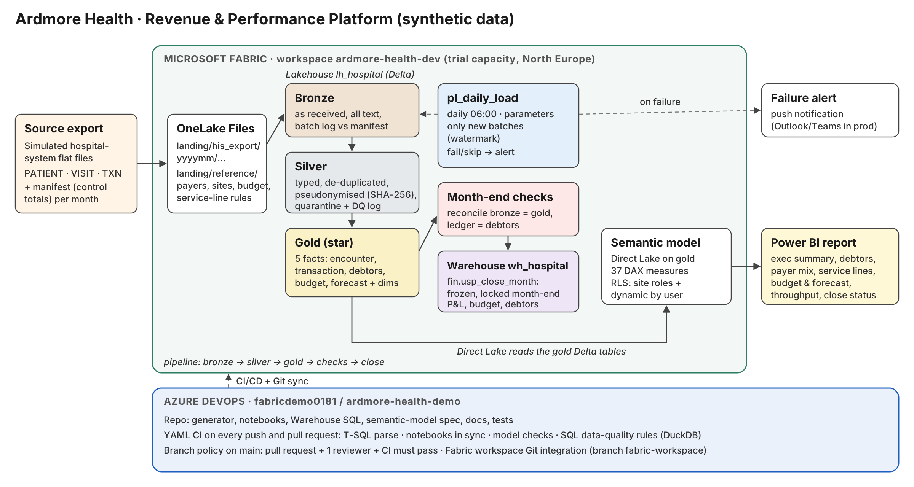

# Architecture

## Data flow

1. **Source export (simulated).** A hospital information system drops one folder per month with three flat files
   (`PATIENT`, `VISIT`, `TXN`) and a `MANIFEST` holding row counts and control totals. This imitates how
   hospital systems typically hand data to BI teams. It is **not** MEDITECH and does not claim to be.
2. **Landing (OneLake Files).** The folders are uploaded as they arrive. Reference files (payers, sites,
   service-line rules, budget, security mapping) sit next to them.
3. **Bronze** (`nb_01_bronze_ingest`). Loads only batches that have not been loaded (checked against
   `etl_batch_log`). Every file is checked against its manifest; a mismatch rejects the whole batch and fails the
   pipeline. Columns stay as text, plus batch id, source file, load time and run id.
4. **Silver** (`nb_02_silver_conform`). Processes only bronze rows newer than the silver watermark
   (`etl_watermark`). Types columns, keeps the latest version of each record, removes duplicate ledger rows,
   replaces the MRN with a salted SHA-256 key, drops names, address, date of birth and membership number,
   fills missing payers (and flags them), maps service lines, and sends rule-breaking rows to `silver_quarantine`.
   Every count goes to `silver_dq_log`.
5. **Gold** (`nb_03_gold_model`). Star schema rebuilt from silver each run (small data; a full rebuild is simpler and
   always consistent). See `data_dictionary.md`.
6. **Month-end checks** (`nb_04_monthend_checks`). Ten reconciliation checks. A blocking failure stops the close.
7. **Warehouse close** (`fin.usp_close_month`). Copies the month's P&L, budget comparison and debtors into the `fin`
   schema and locks the period, so reported figures never change after sign-off.
8. **Forecast** (`nb_05_forecast`). Six months of net revenue per site.
9. **Semantic model** (`nb_06_semantic_model`). Direct Lake on the gold tables, 37 measures, five security roles.
10. **Report.** Two pages built (executive summary, revenue trend), five more designed. See `report_pages.md`.

## Design decisions (and why)

| Decision | Why |
|---|---|
| Bronze keeps everything as text | A bad value never stops the raw copy being stored, so any number can be traced back to the file it came from. |
| Manifest control totals | The standard way to prove a file arrived complete. Catches truncated or partial extracts before they reach finance. |
| Watermark + batch log for incremental loads | Only new months are processed; re-running a batch replaces it instead of doubling it. |
| Pseudonymise in silver, not later | Identifiers never reach the layers analysts and reports use (GDPR data minimisation, Article 5(1)(c)). |
| Quarantine instead of dropping | Bad rows are kept and counted, so finance can see what was excluded and why. |
| Two revenue views: accrual (encounter) and cash (transaction) | Finance reports revenue when care is delivered and cash when it is received. The gap between them is the debtors ledger. |
| Debtors as a month-end snapshot | Balances are semi-additive: you report the balance at a date, never a sum over months. The `Debtors Balance` measure enforces this. |
| Lakehouse for engineering, Warehouse for the close | Gold is rebuilt daily (live view). Finance needs a frozen, locked month-end record they can audit in T-SQL. |
| Direct Lake | Reads the Delta tables directly: no import refresh to schedule, no data copied into the model. |
| Model defined in code (`model_spec.py`) | Measures and roles are versioned in Git and checked by the test suite. |

## Synthetic data: what is real and what is invented

| Element | Source |
|---|---|
| Patients, visits, diagnoses, line-item charges | Synthea (open-source synthetic patient generator, Apache-2.0; data is public domain) |
| Irish counties, sites, MRNs, account numbers | Invented by `generator/build_staging.py` |
| Insurer mix | Weighted by the Health Insurance Authority's 2025 market shares; **assignment to patients is random** |
| Discounts, excesses, payment days, denial rates, cost ratios, budget | **Invented assumptions**, flagged `is_synthetic_assumption = Y` |

## Layers at a glance

| Layer | Tables |
|---|---|
| Control | `etl_batch_log`, `etl_watermark`, `silver_dq_log`, `silver_quarantine` |
| Reference | `ref_payer`, `ref_site`, `ref_service_line`, `ref_service_line_map`, `ref_budget`, `ref_security_user_site` |
| Bronze | `bronze_patient`, `bronze_visit`, `bronze_txn` |
| Silver | `silver_patient`, `silver_visit`, `silver_txn` |
| Gold | `gold_dim_*` (7), `gold_fact_*` (5), `gold_monthend_check`, `gold_sec_user_site` |
| Warehouse `fin` | `dim_site`, `dim_payer`, `dim_service_line`, `fact_close_pnl`, `fact_close_budget`, `fact_close_debtors`, `close_log`, 4 views |
